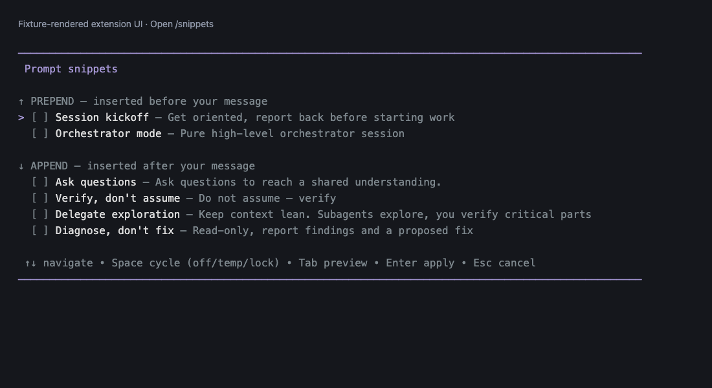
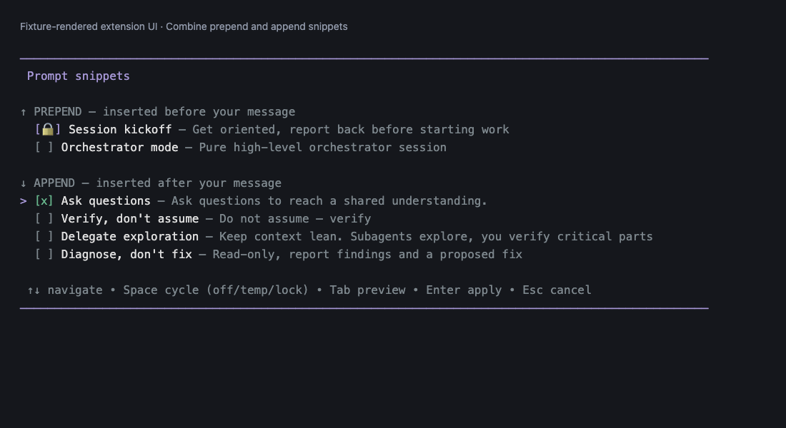
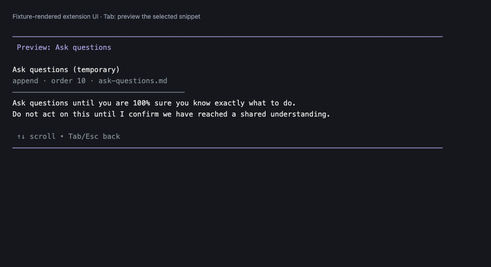

# Pi Prompt Snippets

Reusable prompt rules for [Pi](https://github.com/earendil-works/pi): select snippets, preview their text, and prepend or append them to your next message.



*Actual extension menu, preview, and widget rendered with bundled demo fixtures and Pi's dark theme—not a full live CLI recording.*

## Install

Requires **Pi 1.5 or later**.

```bash
pi install npm:@ivannovr/pi-prompt-snippets
```

The npm command becomes available after the first publication (this checkout is in publication preparation).

Alternatively, install from GitHub: `pi install git:github.com/IvanNovR/pi-prompt-snippets` (or append `@v1.0.0` after that tag exists).

For a local checkout: `pi install /absolute/path/to/pi-prompt-snippets`. Run `/reload` in an existing Pi session after installation.

## Usage

Open **`/snippets`** or press **Alt+S**.

| Key | Action |
| --- | --- |
| ↑ / ↓ | Navigate; scroll in preview |
| Space | Cycle **off → temporary → persistent → off** |
| Tab | Preview snippet text; return to the list |
| Enter | Apply the selection and save persistence changes |
| Esc | Cancel; in preview, return to the list first |

The widget above the editor shows active **↑ prepend** and **↓ append** snippets. Selections clear after use; temporary means **next message**, not the entire session. You can select snippets again at any time.

| Selection menu | Text preview |
| --- | --- |
|  |  |

## Snippet format

Add `.md` files to **`~/.pi/agent/snippets/`**:

```markdown
---
name: Concise answers
description: Keep the response focused
placement: append
order: 100
persistent: false
---
Respond concisely and stay on topic.
```

Frontmatter uses simple `key: value` lines, not full YAML. `name` defaults to the filename, `description` to empty, `placement` to `append`, `order` to `9999`, and `persistent` to `false`. Only `placement: prepend` inserts before your message. Snippets need a nonempty body.

Prepend snippets come first, then your message, then append snippets, separated by blank lines. Each group sorts by `order`, then name. Files are reread when opening the menu or applying snippets.

Bundled defaults are copied when missing at session startup; existing files are not overwritten. **Deleting a bundled default makes it reappear on a later startup**—edit it instead if you want to keep a customized version.

## Persistence

**Persistent is a remembered once-per-session default, not an every-message rule.** It applies automatically to the session's **first recorded user message**, regardless of its input source. A resumed empty session is still eligible; recorded user history, including forked history, prevents another automatic application. Automatic persistence is disabled in JSON mode.

The menu saves `persistent: true` or `false` in the snippet file when you press Enter. Manual selections are independent of the automatic first-message rule, so you can apply a snippet again later.

## Credits

Original idea and implementation: [amosblomqvist/pi-config](https://github.com/amosblomqvist/pi-config/tree/main/extensions/prompt-snippets). Package maintenance and enhancements: [IvanNovR](https://github.com/IvanNovR).

[MIT](LICENSE). The local license retains the repository's verified `Copyright (c) 2026 Ivan` notice. No additional upstream copyright notice was present in the supplied source; upstream attribution is retained above.

## Development and releases

Use Node 24.21.0 and npm 11.19.0: `npm ci`, then `npm test` and `npm run check:package`.
All new commits, including bot commits and squash titles, must use [Conventional Commits](https://www.conventionalcommits.org/) (for example, `feat: add a snippet` or `fix: preserve selection`). Only the verified historical root `Initial commit` (`a90c48e`) is exempt.

See the [maintainer release guide](docs/RELEASING.md) for the gated bootstrap, trusted publishing setup, and partial-publication recovery. Nothing publishes automatically in preparation mode.
