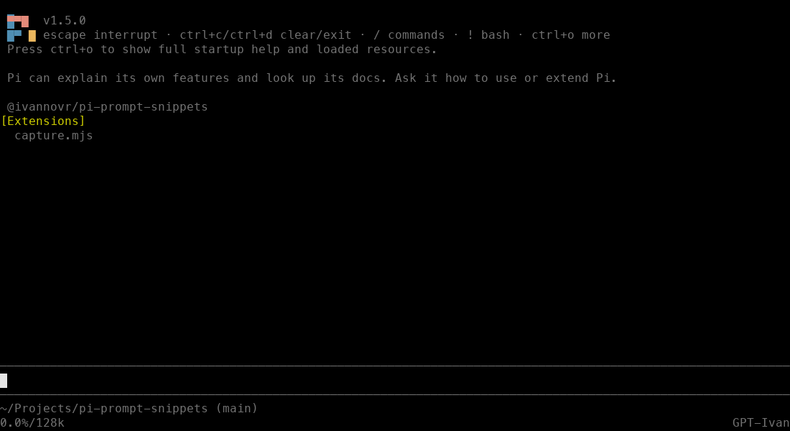
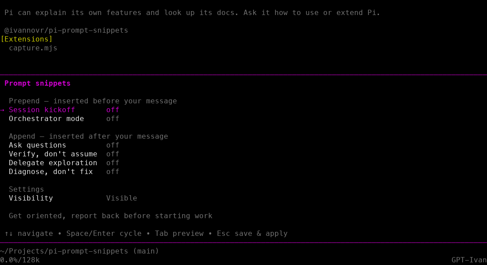
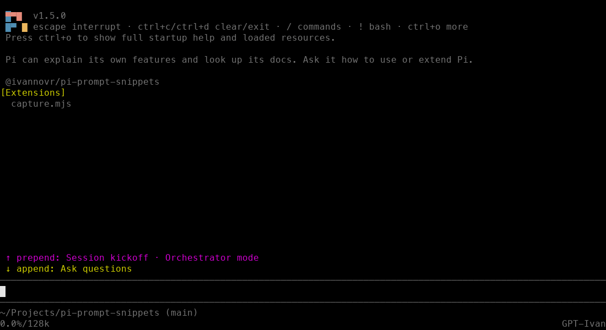

# Pi Prompt Snippets

[](https://www.npmjs.com/package/@ivannovr/pi-prompt-snippets)
[](https://www.npmjs.com/package/@ivannovr/pi-prompt-snippets)
[](https://opensource.org/licenses/MIT)

Reusable prompt rules for [Pi](https://github.com/earendil-works/pi): select snippets, preview their text, and prepend or append them to your next message.



Contributions go through `dev`. Releases are prepared there, promoted to `main`, published with approval and synchronized back to `dev`. See [contributing](CONTRIBUTING.md) and the [maintainer release guide](docs/RELEASING.md).

## Install

Requires **Pi 1.5 or later**.

```bash
pi install npm:@ivannovr/pi-prompt-snippets
```

Alternatively, install from GitHub: `pi install git:github.com/IvanNovR/pi-prompt-snippets`.

For a local checkout: `pi install /absolute/path/to/pi-prompt-snippets`. Run `/reload` in an existing Pi session after installation.

## Contributing and releases

Normal PRs target `dev`. Releases are prepared on dev, promoted through a `dev` -> `main` merge PR, then synchronized back after publication. See [Contributing](CONTRIBUTING.md) and the [release guide](docs/RELEASING.md).

## Usage

Run **`/snippets`** (or **`/snippets settings`**) to open settings,
or press **Alt+S**. Arguments support native Tab completion.

| Key | Action |
| --- | --- |
| ↑ / ↓ | Navigate; scroll in preview |
| Space / Enter | Cycle **off → temporary → persistent → off**; cycle **Visible / Hidden** on Visibility |
| Tab | Preview the selected snippet; return to the list. No action on Visibility |
| Esc | Save all changes and close the list; in preview, return to the list first |

## Selection modes

Highlight a snippet in the menu using ↑ / ↓, then press Space or Enter to change its selection mode: **off**, **temporary**, or **persistent**.

### Temporary

Selects the snippet for one use. After application, its selection returns to **off**. It is not automatically selected in future sessions.

### Persistent

Persistent snippets are automatically selected until the session records its first user message. Rejected or intercepted attempts do not consume this eligibility. Empty resumed sessions are eligible; sessions with recorded user history, including forks, are not.

> [!NOTE]
> Persistent snippets are not applied automatically when Pi runs with `--mode json`

## Placements

Each snippet has a `placement` value:

- **Prepend** — inserts the snippet before your message.
- **Append** — inserts the snippet after your message. This is the default.

The resulting prompt is assembled as:

```
Prepend snippets → Your message → Append snippets
```

Within each group, snippets are sorted by `order`, then by name. Placement is independent of selection mode and visibility.

## Visibility

One setting controls all snippets, both automatic and manual:

- **Visible** (default): show snippet text in the live chat.
- **Hidden**: omit snippet text from the initial display. The model and saved history still receive it, so reloading the session may reveal it.

The setting is saved in **`~/.pi/agent/prompt-snippets-config.json`** as `{"visibility":"visible"}` or `{"visibility":"hidden"}`. Missing or invalid configuration defaults to Visible.

<details>
<summary>Queue and mid-send behavior</summary>

- In **Visible**, every input processed before the first user message is recorded can receive automatic snippets, including multiple queued inputs. In **Hidden**, only the first recorded message receives them automatically.
- A manual **Visible** selection is consumed when its input is processed, even if a later check rejects it. A manual **Hidden** selection waits until a user message is recorded.
- Changing Visibility does not reactivate used snippets. For messages already in flight, the result is best-effort: they may use either mode or omit snippets. A guard prevents the same snippet from being added again through Hidden after Visible insertion; it may also skip snippets after a rejected Visible attempt followed by a switch to Hidden.

</details>

## Showcase

<details>
<summary>Selecting snippets</summary>

Select snippets and preview their text before sending.



</details>

<details>
<summary>Sending in Visible mode</summary>

Snippet text appears in the sent message.



</details>

<details>
<summary>Sending in Hidden mode</summary>

Only your original message appears in the live chat.
The model still receives the snippet text.


</details>

## Snippet format

Add `.md` files to **`~/.pi/agent/snippets/`**:

```markdown
---
name: Concise answers
description: Keep the response focused
placement: append
order: 100
persistent: false
---
Respond concisely and stay on topic.
```

Frontmatter supports simple `key: value` lines, not full YAML.

| Field | Default | Description |
| --- | --- | --- |
| `name` | Filename without `.md` | Display name in the menu |
| `description` | Empty | Short description |
| `placement` | `append` | `prepend` or `append`; see [Placements](#placements) |
| `order` | `9999` | Sort priority within each placement group; lower values come first |
| `persistent` | `false` | Automatically select the snippet for the session's first message.  |

The `---` frontmatter delimiters and a nonempty body are required. Fields may be omitted to use their defaults.
Files are reread when opening the menu or applying snippets.

## Bundled defaults

Bundled snippets are copied to `~/.pi/agent/snippets/` on first start
without overwriting existing files. Updates add only new defaults.
You can edit or delete them. Deleted defaults stay deleted.

Run `/snippets restore` to restore bundled defaults with confirmation.
This recreates missing files and overwrites changes to bundled snippets.
Other custom files are left untouched.

> [!NOTE]
> Use `/snippets restore --yes` to skip confirmation.
> Without an interactive UI (for example, in JSON mode), `--yes` is required.

## Credits

Original idea and implementation: [amosblomqvist/pi-config](https://github.com/amosblomqvist/pi-config/tree/main/extensions/prompt-snippets). Package maintenance and enhancements: [IvanNovR](https://github.com/IvanNovR).

## Development and releases

Use Node 24.21.0 and npm 11.19.0: `npm ci`, then `npm test` and `npm run check:package`.
All new non-merge commits, including bot commits and squash titles, must use [Conventional Commits](https://www.conventionalcommits.org/) (for example, `feat: add a snippet` or `fix: preserve selection`).

See the [maintainer release guide](docs/RELEASING.md) for the gated bootstrap, trusted publishing setup, and partial-publication recovery. Nothing publishes automatically in preparation mode.

## License

[MIT](LICENSE)
