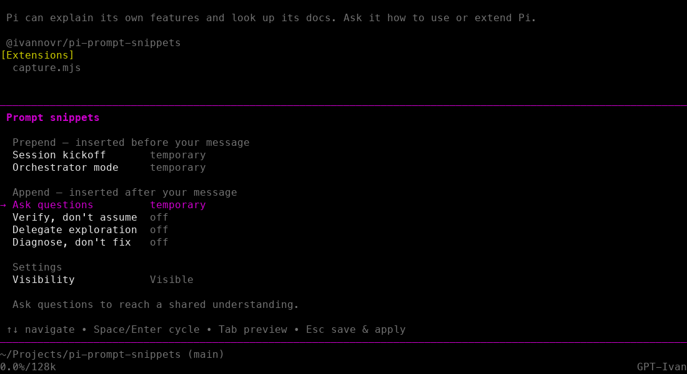
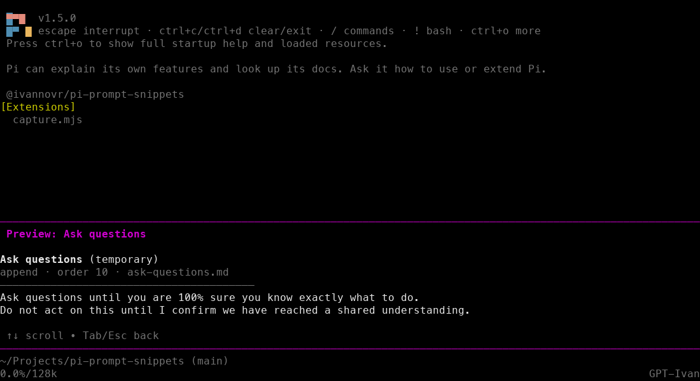

# Pi Prompt Snippets

[](https://www.npmjs.com/package/@ivannovr/pi-prompt-snippets)
[](https://www.npmjs.com/package/@ivannovr/pi-prompt-snippets)
[](https://opensource.org/licenses/MIT)

Reusable prompt rules for [Pi](https://github.com/earendil-works/pi): select snippets, preview their text, and prepend or append them to your next message.


*These images show the earlier menu layout. The current menu uses sectioned settings with Prepend, Append, and Settings groups; preview and widget behavior are retained.*

## Install

Requires **Pi 1.5 or later**.

```bash
pi install npm:@ivannovr/pi-prompt-snippets
```

The npm command becomes available after the first publication (this checkout is in publication preparation).

Alternatively, install from GitHub: `pi install git:github.com/IvanNovR/pi-prompt-snippets` (or append `@v1.0.0` after that tag exists).

For a local checkout: `pi install /absolute/path/to/pi-prompt-snippets`. Run `/reload` in an existing Pi session after installation.

## Usage

Open **`/snippets`** or press **Alt+S**.

| Key | Action |
| --- | --- |
| ↑ / ↓ | Navigate; scroll in preview |
| Space / Enter | Cycle **off → temporary → persistent → off**; cycle **Visible / Hidden** on Visibility |
| Tab | Preview the selected snippet; return to the list. No action on Visibility |
| Esc | Save all changes and close the list; in preview, return to the list first |

The list groups snippets under **Prepend** and **Append**, with **Settings → Visibility** at the bottom. There is no separate save shortcut or cancel action.

The widget above the editor shows active **↑ prepend** and **↓ append** snippets. Selections clear after use; temporary means **next message**, not the entire session. You can select snippets again at any time.

| Selection menu | Text preview |
| --- | --- |
|  |  |

## Snippet format

Add `.md` files to **`~/.pi/agent/snippets/`**:

```markdown
---
name: Concise answers
description: Keep the response focused
placement: append
order: 100
persistent: false
---
Respond concisely and stay on topic.
```

Frontmatter uses simple `key: value` lines, not full YAML. `name` defaults to the filename, `description` to empty, `placement` to `append`, `order` to `9999`, and `persistent` to `false`. Only `placement: prepend` inserts before your message. Snippets need a nonempty body.

Prepend snippets come first, then your message, then append snippets, separated by blank lines. Each group sorts by `order`, then name. Files are reread when opening the menu or applying snippets.

Bundled defaults are copied when missing at session startup; existing files are not overwritten. **Deleting a bundled default makes it reappear on a later startup**—edit it instead if you want to keep a customized version.

## Persistence

**Persistent is a remembered session-start default, not an every-message rule.** Automatic eligibility lasts **until the session records its first user message**, regardless of input source. Rejected or intercepted inputs do not consume that eligibility. A resumed empty session is still eligible; recorded user history, including forked history, prevents another automatic application. Automatic persistence is disabled in JSON mode. See the Visible queue behavior below.

The menu saves `persistent: true` or `false` in the snippet file when you press Esc from the list. Manual selections are independent of the automatic first-message rule, so you can apply a snippet again later.

## Visibility

**Visibility** is a global setting shared by all snippets, both automatic and manual:

- **Visible** (default): prepend/append text is added through Pi's `input` transform before the live user-message render.
- **Hidden**: text is added through Pi's `message_end` replacement after the initial render. The model and saved session receive the full message. Hidden text can become visible when the session is reloaded; this is not a secrecy feature.

The selection is saved in **`~/.pi/agent/prompt-snippets-config.json`**:

```json
{ "visibility": "visible" }
```

Missing or invalid configuration defaults to Visible. Snippet Markdown and frontmatter do not store visibility.

### Visible inputs processed before the first recording

In Visible mode, **every input processed while automatic eligibility is still active receives the selected automatic snippets**. Multiple queued inputs can therefore retain snippets even if only one is the first recorded message. For example, queue `session.steer("A")` while idle, then call `session.prompt("B")`: both input hooks run before either message records, B records first, and both messages contain automatic snippets at their live render and in saved/model content. Inputs processed after that first recording do not receive automatic snippets. This is intentional; no late stripping changes what the user saw.

Hidden mode applies automatic snippets only to the first recorded user message, including this queue case, because it injects at the recording boundary instead of transforming input.

Visible manual selections are consumed by their input transform, so a subsequently rejected/intercepted input consumes the selection, and a queued input can receive it before a different message records. Hidden manual selections wait for a user message to record.

`node scripts/repro-visible-queue.mjs` reproduces the host event ordering offline. The test suite checks both modes through real AgentSession queue handling, including live render snapshots and persisted content.

### Changing Visibility while a message is in flight

Visibility changes take effect immediately, without resetting or rearming snippet selections. Opening/closing the menu or changing only Visibility does not promote automatic selections to manual selections.

For the rare message already being processed or queued during a change, behavior is best-effort: it may follow the old or new mode, or omit snippets. For example, a Hidden queued manual send switched to Visible before recording can omit its snippet. To prevent duplicate insertion on a Visible→Hidden switch, snippet IDs actually inserted by Visible input are excluded from Hidden insertion until the next user recording. This conservative guard can also omit those snippets after a rejected Visible attempt followed by a switch to Hidden. Ordinary fresh Hidden sends are unaffected, and automatic eligibility still survives rejected Visible attempts. The real AgentSession regressions check paused-input and queued transitions for no duplicate reapplication.

## Credits

Original idea and implementation: [amosblomqvist/pi-config](https://github.com/amosblomqvist/pi-config/tree/main/extensions/prompt-snippets). Package maintenance and enhancements: [IvanNovR](https://github.com/IvanNovR).

## Development and releases

Use Node 24.21.0 and npm 11.19.0: `npm ci`, then `npm test` and `npm run check:package`.
All new commits, including bot commits and squash titles, must use [Conventional Commits](https://www.conventionalcommits.org/) (for example, `feat: add a snippet` or `fix: preserve selection`). Only the verified historical root `Initial commit` (`a90c48e`) is exempt.

See the [maintainer release guide](docs/RELEASING.md) for the gated bootstrap, trusted publishing setup, and partial-publication recovery. Nothing publishes automatically in preparation mode.

## License

[MIT](LICENSE)
